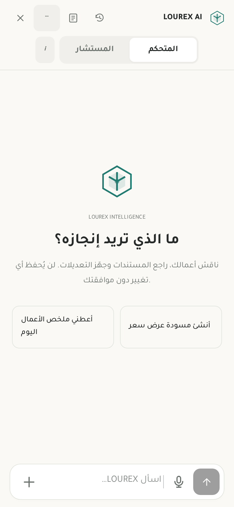
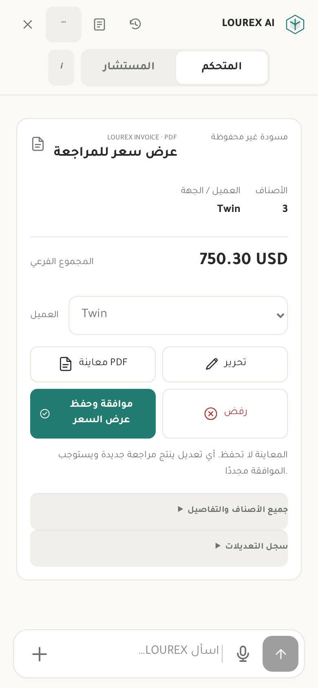
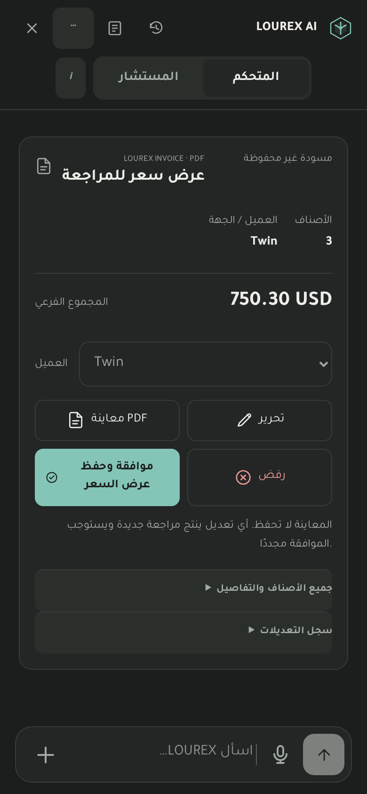
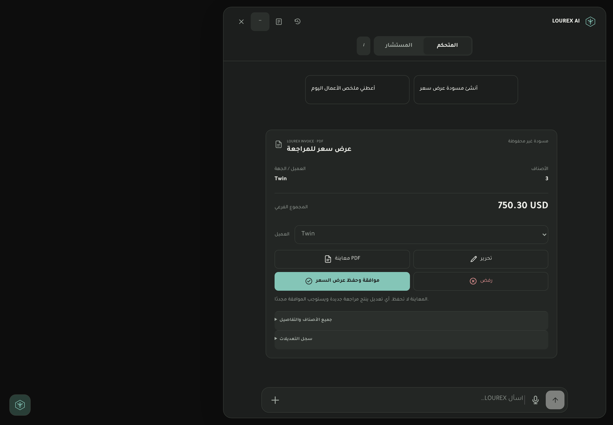

# LOUREX Quiet Workspace

Replaces the 117 KB accumulated AI workspace stylesheet with a single warm-neutral / charcoal presentation owner. Conversation-first layout, compact mode navigation, grouped header utilities, geometric turquoise identity, unframed assistant turns, and a quiet composer share one vocabulary with the application header and bottom navigation.

Document review shows party, line count, subtotal and primary decisions first. Commercial terms and revision tools are disclosed on demand; the existing approval callbacks, review requirements, PDF generation and editing commands are retained. Mobile pricing uses the existing individual line editors instead of a wide table. Desktop retains a side-by-side artifact pane.

## Verification

- `npm run build` passed, including TypeScript and the existing build-time compatibility contracts. A header grouping correction required compilation/build refresh; subsequent CSS corrections were checked by refreshing only emitted presentation assets.
- Local Chromium at 390 × 844: Arabic controller welcome, quotation review using isolated synthetic fixture data, detail disclosure, history and settings render without JavaScript errors or page-level horizontal overflow. Header measured 60 px.
- Light/dark conversation styling and a 1440 × 1000 desktop view inspected. Visual viewport sizing, safe-area insets and reduced-motion preferences are retained in the presentation styles.
- These are local fixture screenshots, not production or physical iPhone/Safari evidence. Actual iOS keyboard, microphone permissions, file uploads and PDF generation were not exercised.
- No live AI requests, accounting calculations, approval execution, invoice saves, inventory actions, database or permission changes, or comprehensive test suites were performed.

## Review images

